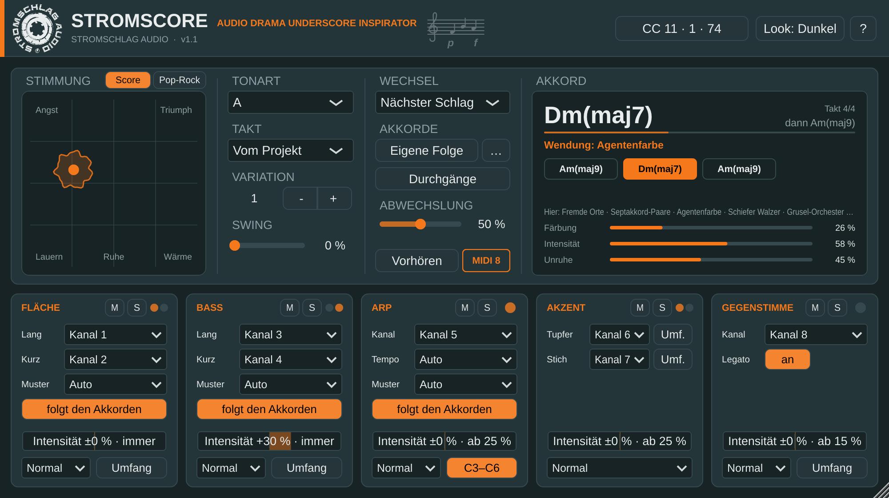
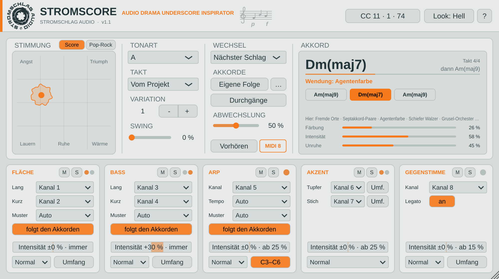
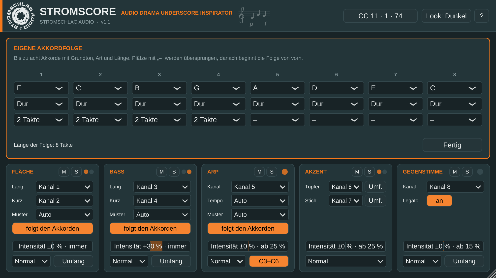
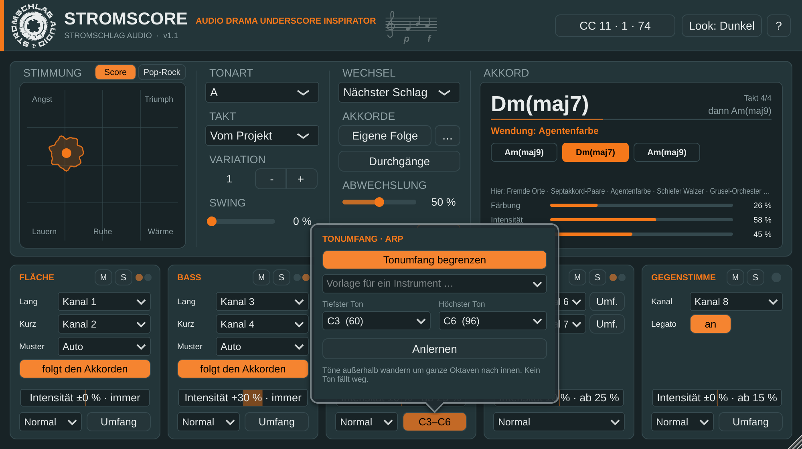

# STROMSCORE – Audio Drama Underscore Inspirator

<picture>
  <source media="(prefers-color-scheme: dark)" srcset="docs/logo-dunkel.png">
  
</picture>

VST3-Instrument für Hörspiel-Produktion. STROMSCORE ist als Inspiration gedacht: Es liefert einen Ausgangspunkt, den du auf deinen
eigenen Instrumenten weiter bearbeitest und veredelst. Es erzeugt Musik zur Untermalung in fünf Ebenen und gibt sie als **MIDI** aus:
Fläche, Bass, Arp, Akzent und Gegenstimme, auf bis zu acht frei wählbaren MIDI-Kanälen. Fläche und Bass trennen lange und kurze
Töne, damit Orchester-Libraries für jede Spielweise das passende Patch bekommen. Die Stimmung steuerst du über ein **Stimmungsfeld** mit drei Achsen: Färbung (dunkel bis hell),
Intensität (ruhig bis aufgewühlt) und Unruhe (sauber bis kratzig). Alle drei lassen sich automatisieren oder mit einem Fader-Controller
live fahren. So folgt die Musik der Szene, vom Lauern über die Panik bis zur Erlösung.

Es läuft im Takt des Projekts, auch in 3/4, 6/8 und ungeraden Takten. Gleiche Einstellungen ergeben immer dieselben Noten, auch nach
einem Sprung oder bei einem Loop. Bewegst du die Stimmung, reagiert die Musik schon am nächsten Schlag. Wer feste Harmonien braucht,
gibt eine **eigene Akkordfolge** vor.

**Es verwendet keine KI.** STROMSCORE arbeitet mit festen Regeln, nicht mit trainierten Modellen und nicht mit fremdem Material. Die
Grundlage ist der Stil, den ich über Jahre für meine Hörspiele entwickelt habe, geprägt von großen Filmkomponisten und der Musik
klassischer Hörspiele. Daraus ist ein Vorrat an Wendungen entstanden: Akkordfolgen, Figuren und Rhythmen, je nach Stimmung gezogen.
Melodien bekannter Stücke werden nicht nachgebaut. Das Ziel: Szenen so zu untermalen, wie ich es selbst tun würde, und das einfacher
zu machen.

**Stand 1.1:** Forschungsphase. Bedienung und Klang werden mit jeder Version weiter verfeinert.

**⬇ Download (Windows · VST3):** https://github.com/StromschlagProductions/Stromscore-vst/releases/latest

*STROMSCORE soll das eigene Komponieren nicht ersetzen. Es macht Spaß und ist lehrreich, Flächen, Bässe und Figuren selbst zu
schreiben und zu hören, wie Harmonie, Rhythmus und Dichte zusammenwirken. Ich bin dankbar, dass ich diesen Weg selbst gegangen
bin, auch wenn er manchmal umständlich war. STROMSCORE soll nur die technische Umsetzung im Alltag einfacher machen.*

– Lars Eickstädt, Stromschlag Audio

## Oberfläche

| Dunkel (Standard) | Hell |
|---|---|
|  |  |

Über **Bearbeiten** legst du die eigene Akkordfolge fest:

Über **Umfang** unten in jedem Ebenen-Kasten begrenzt du die Ebene auf den spielbaren Bereich deines Instruments:

Der Umschalter oben rechts wechselt den Look, die Wahl wird mit dem Projekt gespeichert. Der **?**-Knopf öffnet die Hilfe, über
jedem Regler erscheint beim Darüberfahren ein kurzer Hinweis. Die Oberfläche lässt sich am rechten unteren Fensterrand stufenlos
von 50 % bis 300 % vergrößern oder verkleinern.

## Einrichten in Studio One

1. Eine Instrumentenspur mit **Stromscore** anlegen.
2. Für jede Ebene, die du hören willst, eine eigene Instrumentenspur mit deinem Instrument anlegen.
3. Bei jeder dieser Spuren als Eingang Stromscore wählen und den MIDI-Kanal einstellen. Vorgabe: Fläche lang 1, Fläche kurz 2,
   Bass lang 3, Bass kurz 4, Arp 5, Akzent Tupfer 6, Akzent Stich 7, Gegenstimme 8. Die Kanäle lassen sich in jedem Ebenen-Kasten ändern.
4. Spuren auf Monitor schalten, Wiedergabe starten.

Zum Weiterarbeiten nimmst du die Ausgabe auf diesen Spuren als MIDI auf. Ohne eigene Instrumente hilft **VORHÖREN**: ein einfacher
Testklang direkt aus dem Plugin, auch ohne die Wiedergabe zu starten.

## Das Stimmungsfeld

| Achse | Bedienung | Was sie macht |
|---|---|---|
| Färbung | Punkt waagerecht ziehen · CC 11 | Links dunkel (Bedrohung, Trauer, Lauern), rechts hell (Wärme, Staunen, Triumph). Bestimmt, welche Wendungen gezogen werden, und die Lage der Stimmen. |
| Intensität | Punkt senkrecht ziehen · CC 1 | Unten ruhig und dünn, oben aufgewühlt und dicht. Ebenen setzen ein, Bass und Arp werden schneller, die Fläche voller. |
| Unruhe | Mausrad über dem Feld · CC 74 | Reibung, Halbtöne, Dissonanz, verschobene Betonungen. Bei wenig Intensität einzelne fremde Töne, bei viel Intensität kratzt der ganze Satz. Sichtbar als Ring um den Punkt. |

Unten in der Mitte liegt **Ruhe**, der neutrale Ausgangspunkt; die Ecken heißen Angst, Triumph, Lauern und Wärme. Färbung,
Intensität und Unruhe stehen rechts in der Akkord-Anzeige laufend in Prozent. Eine Wendung dauert acht Takte; die Anzeige rechts oben zeigt den klingenden
Akkord, die Wendung und ihre Akkorde.

**Wechsel:** Bewegst du den Punkt deutlich, setzt die neue Wendung am nächsten Wechselpunkt mit ihrem ersten Akkord ein: am nächsten
Schlag (Vorgabe), am nächsten Takt, alle 2 oder alle 4 Takte. Gehaltene Töne der alten Stimmung enden genau dort, der Arp läuft im Takt
weiter. Kleine Bewegungen lösen keinen Wechsel aus, solange die laufende Wendung noch passt.

**Vorrat:** 48 Wendungen, von Lauern, Trauer, Unruhigem Schlaf und Grusel über Verfolgung, Sog, Achse, Ermittlung, Geheimnis,
Wurmloch, Fremde Orte, Synth-Nächte und Funk bis zu Schneelinien, Gleiten, Offenen Quinten, Sehnsucht, Romantik, Terrassen,
Erhabenem, Heiterkeit, Western, Abenteuer, Erhebung, Fanfare und Triumph. Welche Wendungen an der aktuellen Stelle in Frage kommen,
zeigt die Akkord-Anzeige unter „Hier“. Fährst du mit der Maus über das Feld, erscheinen klein die Wendungen, die dort am nächsten
liegen; rechts oben in der Akkord-Anzeige stehen der nächste Akkord und eine Leiste bis zum Wechsel.

**Genre:** Zwei Knöpfe neben STIMMUNG wählen das Vokabular. **Score** enthält die Wendungen für Filmmusik. **80er Pop-Rock**
enthält 27 eigene Wendungen mit Powerchord-Riffs, Hi-NRG- und Galopp-Bass, SID-Arpeggios, gehackten Flächen, dunklen Synth-Nächten und
Hymnen, dazu Disco-Funk und Fernsehmusik um 1980: Septakkorde über Oktav-Bass, Quintfall-Sequenzen in Moll wie bei einem Teufelsgeiger,
sehnsüchtige Balladen und eine italienische Serenade. Dort spielt die Gegenstimme eine durchgehende, gleichbleibende Hook-Linie. Alle anderen Funktionen bleiben gleich, auch die
eigene Folge, die dann den Pop-Rock-Stil leiht.

**Controller:** Stromscore hört auf seinem MIDI-Eingang auf CC 11, CC 1 und CC 74, passend zu einem Fader-Controller für
Orchester-Instrumente. Der Stromscore-Spur den Controller als Eingang geben und die Fader-Bewegungen als MIDI-Part aufnehmen. Über den
CC-Knopf lässt sich die Zuordnung ändern oder abschalten.

## Weitere Regler

| Regler | Was er macht |
|---|---|
| TONART | Grundton der Tonart. |
| TAKT | Vom Projekt übernehmen oder fest: 4/4, 3/4, 6/8, 5/4, 7/8, 5/8, 12/8. Ungerade Takte bekommen eigene Betonungsgruppen (z. B. 3+3+2+2 im 5/4). |
| VARIATION | Wählt, welche der passenden Wendungen in welcher Phrase drankommt und welche Figuren sie spielt. Die Stimmung bleibt, nur das Arrangement ändert sich. Gleiche Nummer, gleiches Ergebnis. |
| ABWECHSLUNG | Wie viele passende Wendungen sich abwechseln: ganz links immer nur die passendste, weiter rechts auch entferntere Nachbarn. |
| SWING | Verschiebt die Zwischen-Achtel nach hinten, bis zum Triolen-Gefühl. |
| WECHSEL | Wann eine neue Wendung einsetzt: nächster Schlag, nächster Takt, alle 2 oder alle 4 Takte. |
| EIGENE FOLGE | Spielt deine Akkorde statt der Wendungen. Über **Bearbeiten** bis zu acht Akkorde mit Grundton, Art (Dur, Moll, maj7, m7, 7, sus4, sus2, add9, m6, m(maj7), m7b5, dim7, +) und Länge in Takten. Vorgabe: F – C – B – G mit je 2 Takten. Die Akkorde bleiben fest; die Färbung leiht den Stil der Wendung am Punkt im Feld (Figuren, Bass-Muster, Rhythmus der Fläche), Intensität und Unruhe wirken wie sonst. VARIATION wählt die Lage der Fläche. |
| DURCHGÄNGE | Bei viel Intensität erklingt auf dem letzten Schlag eines Akkords kurz die Dominante des nächsten Akkords. Abschaltbar. |
| VORHÖREN | Einfacher Testklang im Plugin. Spielt auch bei stehender DAW mit eigener Uhr im Projekttempo, dann nur als Testklang ohne MIDI an die Spuren. |
| MIDI | Auf die DAW ziehen: die nächsten 8, 16 oder 32 Takte als MIDI-Datei, eine Spur je eingestelltem MIDI-Kanal, mit allen aktuellen Einstellungen. Klick wechselt die Länge. Mit Solo ziehst du einzelne Ebenen heraus. |
| Dynamik per CC | Im Menü des CC-Knopfs unter „Ausgabe an die Spuren“: jeder benutzte Kanal bekommt CC 1 (Dynamik) und CC 11 (Ausdruck) für Orchester-Libraries, mit atmenden Bögen nach der Intensität. Nummern änderbar, abschaltbar. Getrennt von den Controllern am Eingang. |

## Die fünf Ebenen

Oben in jedem Kasten stehen der Name, **Mute** und **Solo** in der Reihenfolge von Studio One und die Lampe, die bei jedem Ton leuchtet
(bei Fläche, Bass und Akzent eine je Kanal). Die Beschreibung jeder Ebene steht im Tooltip über ihrem Kasten. Fläche und Bass spielen
immer, die anderen Ebenen setzen mit der Intensität ein. Der Regler **Intensität** in jedem Kasten verschiebt die Intensität nur für
diese Ebene: weniger macht sie dünner (beim Bass bis zu langen Tönen), mehr macht sie dichter (beim Bass bis zu durchgehenden Achteln),
und sie setzt dann auch bei ruhiger Stimmung ein. Ab wann eine Ebene gerade einsetzt, steht im Regler hinter dem Wert. Alle Ebenen sind
für tongebende Instrumente gedacht, Schlagwerk gehört nicht dazu. Bei Fläche, Bass und Arp bestimmt ein Schalter, ob die Ebene
**den Akkorden folgt** oder **auf dem Grundakkord bleibt**, etwa für einen durchlaufenden Arp über wechselnden Flächen oder einen Bass auf
dem Grundton. Auf Auto folgt das Muster der Wendung. Jede Ebene hat außerdem ihre eigene **Oktavlage** (zwei Oktaven tiefer bis zwei
Oktaven höher).

**MIDI-Kanäle:** Jede Ebene hat ein Auswahlfeld für ihren Kanal (1 bis 16). Mehrere Ebenen dürfen sich einen Kanal teilen: Steht überall
Kanal 1, spielt alles auf einem einzigen Instrument, etwa einem Klavier. Treffen dabei zwei Ebenen denselben Ton, schneidet keine die
andere ab. Fläche und Bass haben je zwei Kanäle, **Lang** und **Kurz**: gehaltene Akkorde, gehaltener Bass, Halbe und Orgelpunkt gehen auf
„Lang“, Schläge, Puls, Staccato, Gated, Achtel, Funk und alle anderen kurzen Muster auf „Kurz“. So spielt ein Sustain-Patch die langen
Töne und ein Staccato- oder Spiccato-Patch die kurzen. Mit demselben Kanal bei beiden spielt alles auf einem Instrument.

**Akzent:** Er wirft nur ab und zu etwas ein und bleibt nie stehen. Der **Tupfer** spielt einzelne kurze, hohe Töne auf Zwischenzeiten,
für Celesta, Glocken, Harfe oder Pizzicato. Der **Stich** ist ein kurzer Schlag in mittlerer bis tiefer Lage an Akkordwechseln, am Ende
der Phrase und als Antwort kurz nach einem Tupfer, für Klavier, Synth-Stab oder tiefe Streicher. Bei wenig Intensität spielt nur der
Tupfer, ab 50 % kommt der Stich dazu, bei viel Intensität schlagen am Phrasenende beide zugleich. Beide haben eigenen Kanal und eigenen
Tonumfang und lassen sich auch gemeinsam auf ein Instrument legen. Bei Unruhe kommt ein fremder, reibender Ton in der Mitte des Akkords
dazu.

**Gegenstimme:** die einzige lange Linie, in mittlerer Lage zwischen Tupfer und Stich. Mit **Legato** an überlappen die Töne minimal,
damit Legato-Patches gebunden spielen; aus setzen sie kurz vor dem nächsten Ton ab.

**Tonumfang:** Orchesterinstrumente spielen nur einen bestimmten Bereich, ein Synth spielt alles. Über **Umfang** neben der Oktave
(beim Akzent über **Umf.** je Tupfer und Stich) begrenzt du jede Ebene auf den tiefsten und höchsten Ton deines Instruments. Vorlagen
gibt es für übliche Instrumente von Violine bis Klavier; genauer geht es mit **Anlernen**: die tiefste und die höchste spielbare Taste
deines Patches auf dem Keyboard drücken. Dabei fällt kein Ton weg. Akkorde rücken als Ganzes in den Bereich, einzelne Töne außerhalb
wandern um Oktaven nach innen, Arpeggios kehren an den Grenzen um und die Gegenstimme sucht ihre Linie im Bereich. Die Oktavlage wirkt
zuerst, der Tonumfang ist die feste Grenze. Auch die herausgezogene MIDI-Datei hält sich daran. Das mittlere C heißt wie in Studio One C3.

| Ebene | Kanal (Vorgabe) | Muster | Auto setzt ein |
|---|---|---|---|
| Fläche | 1 lang · 2 kurz | Gehalten, Schläge (kurze Akkorde auf der Zwischenzeit), Puls, Staccato, Gated (gehackte Achtel); weit gesetzt wie im Orchester | immer |
| Bass | 3 lang · 4 kurz | Gehalten, Halbe, Viertel, Achtel, Puls (Sechzehntel auf einem Ton), Funk, Pendel, Walking, Wechselbass, Herzschlag, Arpeggio, Orgelpunkt, Hi-NRG (Grundton und Oberoktave), Galopp | immer |
| Arp | 5 | Aufwärts, Abwärts, Kreisend, Zelle, Riff, Glitzern, Sprünge, Kaskade, Oktatonisch, Quarten, SID (Dreiklang in Sechzehnteln) · Tempo Viertel, Achtel, Sechzehntel | ab 25 % Intensität |
| Akzent | 6 Tupfer · 7 Stich | Tupfer: einzelne kurze hohe Töne; Stich: kurze Schläge an den Nahtstellen der Musik; bei Unruhe ein fremder, reibender Ton | Tupfer ab 25 %, Stich ab 50 % Intensität, oder bei Unruhe |
| Gegenstimme | 8 | Die einzige lange Linie, schrittweise von Akkord zu Akkord, bewegter mit mehr Intensität, bei Unruhe mit Vorhalten, Legato schaltbar; im Pop-Rock eine durchgehende Hook-Linie | ab 15 % Intensität |

## Installation (Windows)

ZIP entpacken, DAW schließen und den vollständigen Ordner `Stromscore.vst3` nach `C:\Program Files\Common Files\VST3` kopieren.
Danach in der DAW die Plugins neu einlesen.

## Versionen

- **0.1** – erster Test: Noten-Generator mit fünf MIDI-Kanälen.
- **0.2** – Hinweis zur Herkunft der Musik (keine KI, feste Regeln, Grundlage ist mein eigener Stil) in Hilfe und README.
- **0.3** – Ebenen einzeln ein- und ausschaltbar (Aus / Auto / An), Fläche, Bass und Arp wahlweise den Akkorden folgend oder auf dem Grundakkord bleibend. Hängende Töne nach Stopp behoben. Neuer Untertitel „Underscore Inspirator“.
- **0.4** – Stimmungsfeld mit Färbung, Intensität und Unruhe (ersetzt VERLAUF und MODUS), Steuerung per CC 11 / 1 / 74, Vorrat an 22 Wendungen aus Filmmusik und klassischer Hörspielmusik, Muster für Fläche, Bass und Arp, Taktarten inklusive ungerader Takte, Swing, Akkord- und Wendungsanzeige.
- **0.5** – Wechsel schon am nächsten Schlag (wahlweise Takt, 2 oder 4 Takte) mit sauberem Übergang, eigene Akkordfolge mit bis zu acht Akkorden, Oktavlage je Ebene, Fläche und Bass eine Oktave höher, 13 neue Wendungen (35 insgesamt), neue Muster (Staccato, Walking, Wechselbass, Herzschlag, Arpeggio, Sprünge), Oktaven-Bass entfernt, Vorhören auch ohne Wiedergabe, Stimmungsfeld mit „Ruhe“ als Ausgangspunkt, kompaktere Oberfläche.
- **0.6** – 13 neue Wendungen (48 insgesamt), neue Figuren (Kaskade, Oktatonisch, Quarten) und Bass Orgelpunkt, Akkorde mit eigenem Basston, weiter Satz der Fläche, Solo und Mute je Ebene, Intensität je Ebene, ABWECHSLUNG und Anzeige der passenden Wendungen.
- **0.7** – Ebene 5 wird zur Gegenstimme, eigene Folge leiht den Stil der Wendung am Punkt im Feld, VARIATION wählt bei eigener Folge die Lage der Fläche, Durchgangsakkorde zuschaltbar, Anzeige, ab wann jede Ebene einsetzt.
- **0.8** – Genre-Schalter Score / 80er Pop-Rock mit 20 eigenen Wendungen und neuen Mustern (Hi-NRG, Galopp, SID, Gated, Hook-Linie), Dynamik per CC für Orchester-Libraries, Legato der Gegenstimme, MIDI zum Herausziehen, nächster Akkord mit Leiste, Feld-Karte beim Überfahren.
- **0.9** – Beschreibung der Gegenstimme gekürzt, damit sie unter Windows vollständig in den Kasten passt.
- **1.0** – Tonumfang je Ebene für Orchesterinstrumente, mit Vorlagen und Anlernen per Keyboard, ohne dass ein Ton wegfällt. Sieben neue Pop-Rock-Wendungen im Stil der Fernsehmusik um 1980 (27 insgesamt).
- **1.1** – MIDI-Kanal je Ebene frei wählbar, Fläche und Bass mit getrennten Kanälen für lange und kurze Töne, Farbe wird zum Akzent mit Tupfer und Stich, Gegenstimme als einzige lange Linie mit Legato-Schalter, getrennte Lagen für Akzent und Gegenstimme, aufgeräumte Ebenen-Kästen mit Mute und Solo wie in Studio One, größere Tooltip-Schrift, breiteres Fenster.

Alle Release-Hinweise: `docs/releases/`.

## Aufbau

- `Source/ScoreEngine.h`: Noten-Generator mit dem Vorrat an Wendungen, reines C++ ohne JUCE. Die Ausgabe hängt nur von der Projektposition und den Einstellungen ab.
- `Source/PluginProcessor.*`: Plugin-Hülle, MIDI-Ausgabe, Parameter, Controller-Eingang.
- `Source/PluginEditor.*`: Oberfläche mit Stimmungsfeld und Hilfe.
- `Tests/`: Tests für Engine und Plugin. `tools/screenshot.cpp`: erzeugt die Oberflächenbilder aus der echten Oberfläche.

## Qualität und Prüfung

Bei jeder Änderung baut GitHub das Plugin unter Windows, führt die Regressionstests aus und prüft es mit pluginval (Strictness 8).
Die Noten-Engine läuft zusätzlich unter Linux mit Speicher- und Fehlerprüfern. Die Tests prüfen unter anderem, dass über das ganze
Stimmungsfeld, alle Taktarten und alle Muster keine Note hängen bleibt oder doppelt angeschlagen wird und dass das Ergebnis nicht von
der Puffergröße abhängt. Siehe `docs/CI.md`.

## Hinweis

Stromscore wird ohne Gewähr bereitgestellt. Es ist ein Werkzeug für meine eigene Hörspielproduktion unter Windows mit Studio One. Das
MIDI-Routing hängt vom Host ab; andere Hosts sind nicht getestet. Bei Problemen hilft ein Issue mit kurzer Beschreibung.
